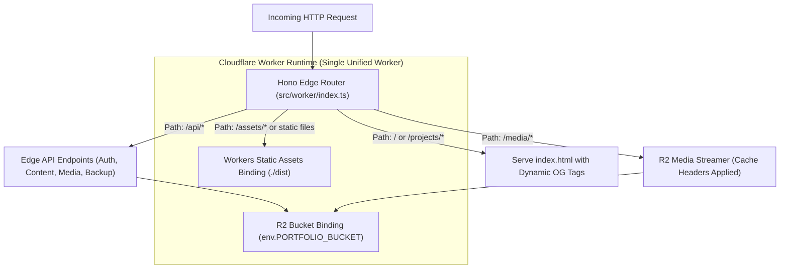

# CLOUDFLARE_RUNTIME_PLAN.md — Edge Runtime, Tooling & Local Development Specification

**Project:** Ravi Dasari — Premium Dynamic Personal Portfolio  
**Target Domain:** `ravi-portfolio.dsecops88.online`  
**Current Milestone:** Prompt 04 of 18 (Storage & Runtime Architecture)  
**Edge Platform:** Cloudflare Workers + Static Assets Binding  

---

## 1. Runtime Topology & Project Architecture

The application runs as a unified, edge-native system combining high-speed client-side rendering with serverless edge API routing:



### 1.1 Technical Stack Specifications
* **Frontend Runtime:** React 18 / 19 SPA built via **Vite**, written in strict TypeScript.
* **Backend Runtime:** **Hono** framework running inside Cloudflare Workers.
* **Styling Engine:** **Tailwind CSS** configured with luxury light-only design tokens.
* **Data Validation:** **Zod** for runtime schema validation on all inputs and storage payloads.
* **Package Manager:** `npm` (standardized across Windows 11 and CI environments).

---

## 2. Cloudflare Wrangler Configuration Specification (`wrangler.toml`)

The complete production and local development configuration blueprint:

```toml
name = "ravi-portfolio"
main = "src/worker/index.ts"
compatibility_date = "2024-10-01"
compatibility_flags = ["nodejs_compat"]

# Static Assets (Serves built Vite frontend from ./dist)
assets = { directory = "./dist", binding = "ASSETS" }

# R2 Standard Storage Binding
[[r2_buckets]]
binding = "PORTFOLIO_BUCKET"
bucket_name = "portfolio-data"
preview_bucket_name = "portfolio-data-dev"

# Production Custom Domain Routing
routes = [
  { pattern = "ravi-portfolio.dsecops88.online/*", zone_name = "dsecops88.online" }
]

# Environment Variables (Public)
[vars]
ENVIRONMENT = "production"
PUBLIC_DOMAIN = "ravi-portfolio.dsecops88.online"
TURNSTILE_SITE_KEY = "0x4AAAAAA..."

# Development Environment Overrides
[env.development]
vars = { ENVIRONMENT = "development", PUBLIC_DOMAIN = "localhost:8787" }
```

---

## 3. Local Development Strategy (Windows 11 + Antigravity IDE)

To enable 100% offline development and unit/integration testing without touching live cloud resources:

### 3.1 Local Emulation Stack
* **Miniflare 3:** Built directly into Wrangler CLI (`wrangler dev`).
* **Local R2 Emulation:** Miniflare emulates Cloudflare R2 on the local filesystem (`.wrangler/state/v3/r2`).
* **Local Secrets Management:** Secrets are stored in `.dev.vars` (strictly excluded from Git):
  ```ini
  SESSION_SECRET="local-development-secret-key-32-chars-minimum"
  ADMIN_PASSWORD_HASH="$pbkdf2$100000$local_salt_hex$local_derived_hash_hex"
  TURNSTILE_SECRET_KEY="1x0000000000000000000000000000000AA" # Cloudflare dummy testing key
  ```

### 3.2 Development Workflows
1. `npm run dev:client`: Runs Vite development server for fast HMR UI editing.
2. `npm run dev:worker`: Runs Wrangler edge worker with local Miniflare R2 bindings.
3. `npm run build`: Compiles Vite static assets to `./dist` and bundles Worker entrypoint.
4. `npm run test`: Executes Vitest suite against local schema validators and edge handlers.

---

## 4. Mock vs. Real Integration Boundaries

To maintain rigorous engineering honesty, we explicitly define what can be validated locally versus what requires real Cloudflare production deployment:

| Capability | Local Emulation (`wrangler dev`) | Real Cloudflare Production Verification |
| :--- | :--- | :--- |
| **Hono API Routing** | Verified 100% locally | Verified on edge CDN |
| **R2 CRUD & File Uploads** | Verified via Miniflare local R2 | Verified on global R2 Standard storage |
| **ETag Concurrency (OCC)** | Verified via conditional write checks | Verified under live multi-request edge timing |
| **Session Cookies & Auth** | Verified via local browser cookies | Verified under live HTTPS `Secure` flags |
| **Custom Subdomain DNS** | Not testable locally (uses `localhost`) | **Requires real Cloudflare DNS binding** |
| **Cloudflare Turnstile** | Testable via dummy Cloudflare test keys | **Requires real Turnstile production siteverify** |
| **Global CDN Cache Purge** | Simulated via in-memory cache | **Requires live Cloudflare Cache API** |

> [!CAUTION]
> Testing with Miniflare local emulation proves code correctness, but will **never be labeled as production integration verification**. Production verification will occur exclusively in Prompts 17 and 18 under owner supervision.

---

## 5. Free-Tier Quota Monitoring & Budget Safeguards

* **Worker CPU Budget:** The application is architected to execute all API requests in **under 8ms** CPU time, well below the free-tier limit of **10ms/request**.
* **Worker Bundle Budget:** Vite + Hono compiles to **<150 KB** gzipped, far below the **1 MB** free-tier script limit.
* **Class A & B R2 Safeguards:** Aggressive Cloudflare Edge caching ensures 95%+ of visitor requests never trigger R2 Class B operations.
* **Storage Cap:** Automatic deletion of superseded media assets and a rolling 50-item limit on JSON backup snapshots ensure storage remains under **500 MB** (well within the **10 GB** free allowance).

