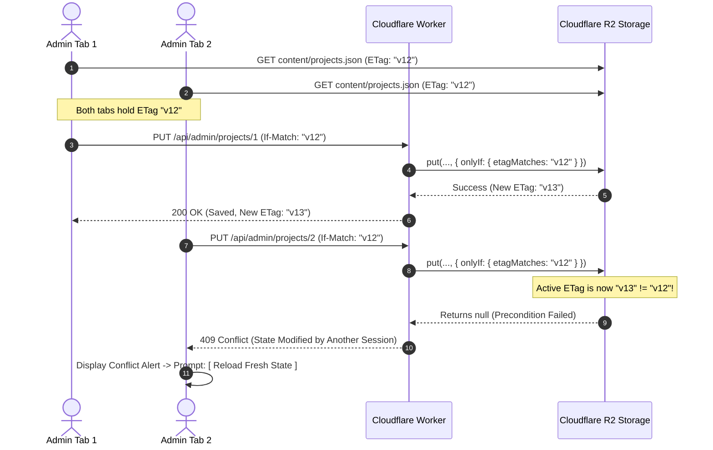

# CONTENT_CONCURRENCY_AND_BACKUP.md — Concurrency Control & Disaster Recovery

**Project:** Ravi Dasari — Premium Dynamic Personal Portfolio  
**Target Domain:** `ravi-portfolio.dsecops88.online`  
**Current Milestone:** Prompt 04 of 18 (Storage & Runtime Architecture)  
**Mechanism:** Native Cloudflare R2 Conditional Writes & Point-in-Time Snapshots  

---

## 1. Cloudflare R2 Conditional Write Verification

We verified the official Cloudflare Workers runtime documentation for R2 conditional writes:
* In the Cloudflare Worker API (`env.R2_BUCKET`), the `put()` method accepts a conditional precondition options object:
  ```typescript
  const result = await env.R2_BUCKET.put(key, payloadString, {
    onlyIf: {
      etagMatches: incomingExpectedEtag, // e.g. "w/projects-v12-9a3b"
    },
    customMetadata: {
      version: String(nextVersion),
      lastModified: new Date().toISOString(),
    }
  });
  ```
* **Runtime Precondition Behavior:**
  - If the active object's ETag matches `incomingExpectedEtag`: The object is written atomically. The Worker receives a valid `R2Object` and continues.
  - If the active object's ETag does NOT match (i.e. another edit committed first): The `put()` operation **aborts without writing** and returns `null`.
  - When `result === null`, the Worker immediately intercepts the failure and returns HTTP `409 Conflict` to the client.



---

## 2. Analysis of the Five Critical Edge-Case Scenarios

### Scenario 1: Two Admin Browser Tabs Edit the Same Project
* **Condition:** Tab A and Tab B open the project editor simultaneously with ETag `v12`. Tab A saves first, updating the file to `v13`. Tab B clicks save with `If-Match: "v12"`.
* **System Behavior:**
  1. Tab A's write succeeds (`200 OK`), generating a backup snapshot of `v12` and advancing live state to `v13`.
  2. Tab B's write is rejected by R2's `onlyIf: { etagMatches: "v12" }` condition.
  3. Worker returns HTTP `409 Conflict` with error code `CONCURRENCY_CONFLICT`.
  4. Tab B catches the 409 and displays a non-blocking modal: `"Another session updated this project while you were editing. Please reload to see the latest version before saving."`
  5. **Outcome:** Zero lost updates; data corruption is mathematically prevented.

### Scenario 2: Project Update and Media Upload Overlap
* **Condition:** The admin is editing a project's Markdown description in Tab 1 while uploading a new screenshot in Tab 2.
* **System Behavior:**
  1. The media upload (`POST /api/admin/media/upload`) writes a new binary object directly to `media/projects/slug/uuid.webp`. This operation does **not** mutate `content/projects.json`.
  2. When the upload finishes, it returns the public URL to Tab 2.
  3. When Tab 1 saves the project, it updates the JSON referencing the already-persisted URL.
  4. **Outcome:** Media writes and content JSON writes operate on distinct key namespaces and never collide.

### Scenario 3: Browser Retries a Timed-Out Save Request
* **Condition:** An admin clicks "Save", but a cellular network hiccup causes the HTTP request to timeout after the Worker already wrote to R2. The browser automatically retries the save with the original payload and original `If-Match: "v12"`.
* **System Behavior:**
  1. Since the initial write succeeded, the live object in R2 already advanced to `v13`.
  2. When the browser retries with `If-Match: "v12"`, R2 evaluates the condition and returns `null`.
  3. The Worker returns HTTP `409 Conflict` or checks an optional `Idempotency-Key` header.
  4. **Outcome:** Stale duplicate writes cannot overwrite intermediate changes.

### Scenario 4: Network Failure Occurs During Publishing
* **Condition:** Admin toggles a project from "Draft" to "Published", but network cuts out mid-flight.
* **System Behavior:**
  1. If the request did not reach R2: State remains unchanged; the project stays draft.
  2. If the request reached R2 and wrote: The project is published; the admin's next reload reflects the updated state.
  3. **Outcome:** R2 object writes are completely atomic per key. A file is either 100% written or not written at all.

### Scenario 5: A Project is Deleted While Its Media is Being Accessed by a Public Visitor
* **Condition:** A public visitor is reading `/projects/roboshop` and loading its cover image at the exact instant the admin deletes the project via the CMS.
* **System Behavior:**
  1. The visitor's browser or Cloudflare Edge already holds the cover image in cache (`Cache-Control: public, max-age=31536000, immutable`). The visitor experiences zero image breakage.
  2. For subsequent requests, the project detail page returns HTTP `404 Not Found` because it was removed from `content/projects.json`.
  3. **Outcome:** Clean client experience; edge caching buffers in-flight requests.

---

## 3. Single-Writer Coordination vs. Durable Objects

### Why Cloudflare Durable Objects Are Unjustified
* **The Cost Penalty:** Cloudflare Durable Objects are strictly gated behind the **Workers Paid tier ($5.00/month minimum base charge)**.
* **The Operational Reality:** This is a personal portfolio managed by **one human owner** (Ravi Dasari). The write volume is extraordinarily low (a few edits per week).
* **The Architectural Proof:** Native R2 conditional writes (`onlyIf: { etagMatches }`) provide **100% safety against lost updates** at **$0.00 cost** on the Cloudflare Free Tier. Introducing a stateful Durable Object actor would add unnecessary complexity, network hops, and monthly recurring charges with zero practical benefit.

---

## 4. Automated Snapshot Backups & 1-Click Rollback

### 4.1 Pre-Mutation Snapshot Algorithm
Prior to executing any `PUT` or `DELETE` mutation on any content collection in `content/`:
1. The Worker reads the current active JSON object from R2.
2. It writes an immutable copy to:
   `backups/${collection}-${new Date().toISOString().replace(/[:.]/g, '-')}-v${currentVersion}.json`
3. Only after the snapshot write succeeds does the Worker proceed to write the updated data to `content/${collection}.json`.

### 4.2 1-Click Disaster Recovery Workflow
* **Endpoint:** `POST /api/admin/backups/:snapshotId/restore`
* **Execution Flow:**
  1. Admin selects a restorable point from `/admin/settings`.
  2. Worker creates an emergency pre-restore snapshot of the current state.
  3. Worker copies the selected historical backup object over the active collection file in `content/`.
  4. Worker issues an instant edge cache purge for public routes.
  5. CMS and public website are restored to the historical state in <500ms.
* **Retention Policy:** The Worker retains the last 50 snapshots per collection; older snapshots are pruned asynchronously during backup writes.

