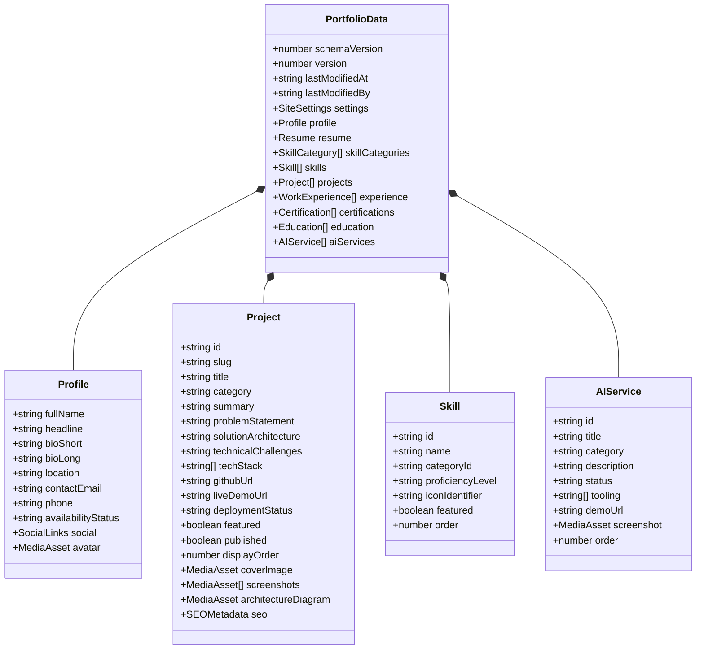

# CONTENT_SCHEMA_PLAN.md — Comprehensive Data Model & Content Schemas

**Project:** Ravi Dasari — Premium Dynamic Personal Portfolio  
**Target Domain:** `ravi-portfolio.dsecops88.online`  
**Current Milestone:** Prompt 02 of 18 (System Architecture Planning)  

---

## 1. Data Model Philosophy & Storage Structure

All dynamic portfolio content lives inside a single, highly structured, type-safe JSON document stored in Cloudflare R2:
- **Active State Key:** `content/portfolio-data.json`
- **Backup Key Pattern:** `backups/portfolio-data-${timestamp}-v${version}.json`
- **Data Validation Engine:** Runtime Zod Schemas enforcing strict structural typing before any write operation.



---

## 2. Comprehensive TypeScript & Zod Schemas

### 2.1 Media Asset Reference Schema
```typescript
import { z } from 'zod';

export const MediaAssetSchema = z.object({
  id: z.string().uuid(),
  key: z.string().min(1),             // R2 storage key, e.g. "media/projects/roboshop-arch.webp"
  url: z.string().url(),              // Public CDN URL, e.g. "https://ravi-portfolio.dsecops88.online/media/..."
  filename: z.string().min(1),        // Original filename
  mimeType: z.enum([
    'image/webp',
    'image/png',
    'image/jpeg',
    'image/svg+xml',
    'application/pdf'
  ]),
  sizeBytes: z.number().int().positive().max(10 * 1024 * 1024), // Max 10MB
  uploadedAt: z.string().datetime(),
  altText: z.string().optional(),
});
```

### 2.2 Profile Schema
```typescript
export const SocialLinksSchema = z.object({
  github: z.string().url(),
  linkedin: z.string().url(),
  email: z.string().email(),
  twitter: z.string().url().optional(),
  medium: z.string().url().optional(),
  calendar: z.string().url().optional(),
});

export const ProfileSchema = z.object({
  fullName: z.literal('Ravi Dasari'),
  headline: z.string().min(10).max(120),
  bioShort: z.string().min(50).max(300),
  bioLong: z.string().min(100).max(3000),
  location: z.string().min(2).max(100),
  contactEmail: z.string().email(),
  availabilityStatus: z.enum([
    'Available for Engineering Roles & Consulting',
    'Open to Select Advisory Roles',
    'Currently Committed'
  ]),
  social: SocialLinksSchema,
  avatar: MediaAssetSchema.nullable(),
});
```

### 2.3 Resume Schema & Format Policy
```typescript
export const ResumeSchema = z.object({
  activeResume: MediaAssetSchema.nullable(),
  format: z.literal('application/pdf'), // STRICT POLICY: PDF ONLY
  lastUpdated: z.string().datetime(),
  fileSizeBytes: z.number().int().positive(),
  versionTag: z.string().min(1),        // e.g. "v2026.1"
  auditHistory: z.array(z.object({
    key: z.string(),
    filename: z.string(),
    uploadedAt: z.string().datetime(),
    sizeBytes: z.number().int(),
  })).default([]),
});
```

#### Resume Format Policy: PDF vs DOCX Analysis & Decision
- **Evaluation:** Word documents (`.docx`) introduce severe security, formatting, and rendering liabilities:
  1. `.docx` files cannot be rendered natively inside browser viewports without third-party external cloud viewers (Google Docs Viewer / Microsoft Office 365) which leaks private documents and fails offline/CSP policies.
  2. Formatting, typography, margins, and page breaks in `.docx` vary unpredictably across Microsoft Word, Google Docs, LibreOffice, and mobile viewers.
  3. Binary `.docx` files pose macro-virus inspection challenges and lack deterministic rendering.
- **Strict Architectural Policy:**
  - **Public Download & Viewing:** Strictly **PDF (`application/pdf`) Only**.
  - **Admin Upload:** Only verified PDF files (checked via magic bytes `%PDF-`) are accepted for the published resume.
  - If the owner requires editing in Word, the owner edits locally and exports to PDF before uploading through the Admin CMS.

### 2.4 Projects Schema (Generic Schema for All Projects)
```typescript
export const ProjectSchema = z.object({
  id: z.string().uuid(),
  slug: z.string().regex(/^[a-z0-9]+(?:-[a-z0-9]+)*$/, 'Must be valid URL-safe slug'),
  title: z.string().min(3).max(100),
  category: z.enum([
    'DevSecOps & Cloud',
    'Android Engineering',
    'E-Commerce Engineering',
    'AI & Automation',
    'Backend Systems'
  ]),
  summary: z.string().min(20).max(250),
  problemStatement: z.string().min(50).max(2000),
  solutionArchitecture: z.string().min(50).max(3000),
  technicalChallenges: z.string().min(50).max(2000),
  techStack: z.array(z.string().min(1)).min(1),
  githubUrl: z.string().url().nullable().optional(),
  liveDemoUrl: z.string().url().nullable().optional(),
  deploymentStatus: z.string().min(3).max(100),
  featured: z.boolean().default(false),
  published: z.boolean().default(false),
  displayOrder: z.number().int().default(0),
  coverImage: MediaAssetSchema.nullable().optional(),
  screenshots: z.array(MediaAssetSchema).default([]),
  architectureDiagram: MediaAssetSchema.nullable().optional(),
  seo: z.object({
    metaTitle: z.string().max(70),
    metaDescription: z.string().max(160),
    keywords: z.array(z.string()),
  }),
});
```

### 2.5 Skills Schema
```typescript
export const SkillCategorySchema = z.object({
  id: z.string().min(2).max(50),      // e.g. "devsecops-cloud"
  name: z.string().min(2).max(50),    // e.g. "DevSecOps & Cloud Infrastructure"
  icon: z.string().min(1),            // Lucide icon identifier
  order: z.number().int().default(0),
});

export const SkillSchema = z.object({
  id: z.string().uuid(),
  name: z.string().min(1).max(50),
  categoryId: z.string().min(2).max(50),
  proficiencyLevel: z.enum(['Core Competency', 'Advanced', 'Proficient']),
  iconIdentifier: z.string().min(1),
  featured: z.boolean().default(false),
  order: z.number().int().default(0),
});
```

### 2.6 Work Experience & Education Schema
```typescript
export const WorkExperienceSchema = z.object({
  id: z.string().uuid(),
  role: z.string().min(2).max(100),
  company: z.string().min(2).max(100),
  companyUrl: z.string().url().optional(),
  location: z.string().min(2).max(100),
  startDate: z.string().regex(/^\d{4}-\d{2}$/, 'YYYY-MM format'),
  endDate: z.string().regex(/^\d{4}-\d{2}$/, 'YYYY-MM format').nullable(), // null = Present
  isCurrent: z.boolean().default(false),
  achievements: z.array(z.string().min(10)).min(1),
  techStack: z.array(z.string()).default([]),
  order: z.number().int().default(0),
});

export const CertificationSchema = z.object({
  id: z.string().uuid(),
  title: z.string().min(2).max(120),
  issuer: z.string().min(2).max(100),
  issueDate: z.string().regex(/^\d{4}-\d{2}$/, 'YYYY-MM format'),
  expiryDate: z.string().regex(/^\d{4}-\d{2}$/, 'YYYY-MM format').nullable().optional(),
  credentialId: z.string().optional(),
  credentialUrl: z.string().url().optional(),
  badgeImage: MediaAssetSchema.nullable().optional(),
  order: z.number().int().default(0),
});

export const EducationSchema = z.object({
  id: z.string().uuid(),
  degree: z.string().min(2).max(120),
  institution: z.string().min(2).max(120),
  fieldOfStudy: z.string().min(2).max(100),
  startYear: z.number().int().min(1990).max(2040),
  endYear: z.number().int().min(1990).max(2040).nullable(),
  order: z.number().int().default(0),
});
```

### 2.7 AI Services Schema (Mandatory 4-State Integrity)
```typescript
export const AIServiceSchema = z.object({
  id: z.string().uuid(),
  title: z.string().min(3).max(100),
  category: z.enum([
    'AI Agents',
    'AI Chat Assistants',
    'AI Voice Assistants',
    'Automated Outbound AI Calling',
    'WhatsApp Business Automation',
    'AI Workflow Automation',
    'CRM/API Integrations',
    'Custom AI Solutions'
  ]),
  description: z.string().min(20).max(1000),
  status: z.enum([
    'Verified Live Implementation',
    'Working Prototype',
    'In Active Development',
    'Planned Capability'
  ]),
  tooling: z.array(z.string()).default([]),
  demoUrl: z.string().url().nullable().optional(),
  screenshot: MediaAssetSchema.nullable().optional(),
  order: z.number().int().default(0),
});
```

### 2.8 Site Settings & Root State Schema
```typescript
export const SiteSettingsSchema = z.object({
  siteTitle: z.string().min(3).max(100).default('Ravi Dasari — Senior DevSecOps & Cloud Engineer'),
  metaDescription: z.string().min(20).max(200),
  ogImage: MediaAssetSchema.nullable().optional(),
  contactEmail: z.string().email(),
  footerText: z.string().max(200),
  turnstileSiteKey: z.string().optional(),
  analyticsEnabled: z.boolean().default(false),
});

export const PortfolioDataSchema = z.object({
  schemaVersion: z.literal(1),
  version: z.number().int().positive(),
  lastModifiedAt: z.string().datetime(),
  lastModifiedBy: z.string().min(1),
  settings: SiteSettingsSchema,
  profile: ProfileSchema,
  resume: ResumeSchema,
  skillCategories: z.array(SkillCategorySchema),
  skills: z.array(SkillSchema),
  projects: z.array(ProjectSchema),
  experience: z.array(WorkExperienceSchema),
  certifications: z.array(CertificationSchema),
  education: z.array(EducationSchema),
  aiServices: z.array(AIServiceSchema),
});

export type PortfolioData = z.infer<typeof PortfolioDataSchema>;
```

---

## 3. Mandatory Initial Projects Content Specification

All four required projects conform strictly to the generic `ProjectSchema` without special-case code:

### Project 1: RoboShop E-Commerce DevSecOps Project
* **Slug:** `roboshop-devsecops`
* **Title:** `RoboShop E-Commerce DevSecOps Pipeline & Infrastructure`
* **Category:** `DevSecOps & Cloud`
* **Deployment Status:** `Production Pipeline Automated`
* **Featured:** `true` | **Published:** `true`
* **Core Tech Stack:** `Docker, Kubernetes, Jenkins, GitHub Actions, SonarQube, Trivy, Vault, Terraform, AWS, Linux`
* **Summary:** End-to-end automated DevSecOps delivery pipeline supporting a multi-tier microservices e-commerce application.

### Project 2: Zynpath Android Puzzle Game
* **Slug:** `zynpath-puzzle-game`
* **Title:** `Zynpath — Android Spatial Logic Game`
* **Category:** `Android Engineering`
* **Deployment Status:** `Google Play Closed Testing ONLY` *(STRICT: Never claim production release)*
* **Featured:** `true` | **Published:** `true`
* **Core Tech Stack:** `Kotlin, Android SDK, Jetpack Compose, Clean Architecture, StateFlow, Coroutines`
* **Summary:** Mobile spatial puzzle application featuring custom rendering mechanics and offline-first level progression, currently in Google Play Closed Testing tracks.

### Project 3: Mandi Ledger Android Business Application
* **Slug:** `mandi-ledger-app`
* **Title:** `Mandi Ledger — Agricultural Commodity Accounting & Billing`
* **Category:** `Android Engineering`
* **Deployment Status:** `Published on Google Play Store`
* **Featured:** `true` | **Published:** `true`
* **Live Demo URL:** Verified Google Play Store listing URL
* **Core Tech Stack:** `Kotlin, Android SDK, Room DB, Offline Sync, PDF Invoice Generator, Material 3`
* **Summary:** Production Android accounting and transactional ledger application designed for wholesale agricultural trading and daily commission accounting.

### Project 4: NEXORA Interactive E-Commerce Platform
* **Slug:** `nexora-ecommerce`
* **Title:** `NEXORA — Luxury E-Commerce Experience Platform`
* **Category:** `E-Commerce Engineering`
* **Deployment Status:** `Interactive Showcase Demo (Static Frontend Only)`
* **Live Demo URL:** `https://nexora.dsecops88.online`
* **Featured:** `true` | **Published:** `true`
* **Factual Status Note:** Fully responsive client-side luxury shopping experience. Public demo is a static visual showcase; live AI concierge and payment gateway checkouts are not deployed in this demo environment.
* **Core Tech Stack:** `TypeScript, Modern Web Architecture, Cloudflare Edge, Tailwind CSS, Dynamic State Management`

