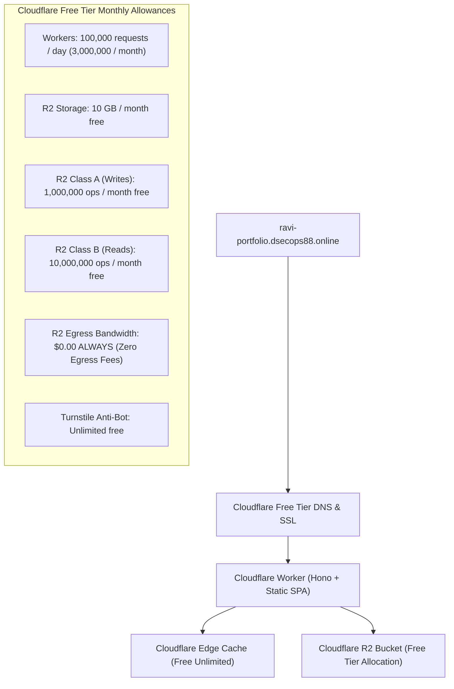

# DEPLOYMENT_AND_COST_PLAN.md — Operational Economics & Cloudflare Deployment Strategy

**Project:** Ravi Dasari — Premium Dynamic Personal Portfolio  
**Target Domain:** `ravi-portfolio.dsecops88.online`  
**Current Milestone:** Prompt 02 of 18 (System Architecture Planning)  

---

## 1. Cloudflare Resource Topology & Zero-Cost Architecture

The system is architected to operate **100% within Cloudflare's Free Tier allowances** while supporting production traffic, enterprise-grade security, and dynamic content updates.

---

## 2. Monthly Operational Cost Models (Scenarios A, B, C)

The following tables evaluate operational volume across three realistic traffic profiles.

### Volume Assumptions
* Average page payload (HTML + CSS + JS): ~350 KB (served from edge cache).
* Dynamic Content JSON: ~25 KB (cached at edge for 24 hours, purged on CMS write).
* Average images per session: 6 images (cached at edge).
* Cache hit ratio at Cloudflare Edge: **95%+**.

---

### Scenario A: Low Traffic (100 Visitors / Month)
*Typical for initial launch or personal portfolio review.*

| Component | Metric / Volume | Free Allowance | Billable Usage | Estimated Cost |
| :--- | :--- | :--- | :--- | :--- |
| **Worker Requests** | ~1,200 req / mo | 3,000,000 / mo | 0 | **$0.00** |
| **R2 Storage** | ~150 MB (images, resume) | 10 GB | 0 | **$0.00** |
| **R2 Class A Ops (Writes)** | ~50 ops (admin edits) | 1,000,000 / mo | 0 | **$0.00** |
| **R2 Class B Ops (Reads)** | ~300 ops (cache misses) | 10,000,000 / mo | 0 | **$0.00** |
| **R2 Egress Bandwidth** | ~400 MB | Unlimited Free | 0 | **$0.00** |
| **Authentication** | Built-in Web Crypto | Included in Worker | 0 | **$0.00** |
| **Coordination / Locking** | R2 ETags (No Durable Object) | Included in R2 | 0 | **$0.00** |
| **Turnstile Anti-Bot** | ~15 form checks | Unlimited Free | 0 | **$0.00** |
| **Total Monthly Cost** | — | — | — | **$0.00 / month** |

---

### Scenario B: Moderate Traffic (1,000 Visitors / Month)
*Active job applications, networking, and public project visibility.*

| Component | Metric / Volume | Free Allowance | Billable Usage | Estimated Cost |
| :--- | :--- | :--- | :--- | :--- |
| **Worker Requests** | ~12,000 req / mo | 3,000,000 / mo | 0 | **$0.00** |
| **R2 Storage** | ~300 MB | 10 GB | 0 | **$0.00** |
| **R2 Class A Ops (Writes)** | ~150 ops | 1,000,000 / mo | 0 | **$0.00** |
| **R2 Class B Ops (Reads)** | ~2,500 ops (cache misses) | 10,000,000 / mo | 0 | **$0.00** |
| **R2 Egress Bandwidth** | ~4 GB | Unlimited Free | 0 | **$0.00** |
| **Authentication** | Built-in Web Crypto | Included in Worker | 0 | **$0.00** |
| **Coordination / Locking** | R2 ETags (No Durable Object) | Included in R2 | 0 | **$0.00** |
| **Turnstile Anti-Bot** | ~150 form checks | Unlimited Free | 0 | **$0.00** |
| **Total Monthly Cost** | — | — | — | **$0.00 / month** |

---

### Scenario C: High Traffic / Viral Reach (10,000 Visitors / Month)
*Featured on tech forums, LinkedIn posts, or viral GitHub repositories.*

| Component | Metric / Volume | Free Allowance | Billable Usage | Estimated Cost |
| :--- | :--- | :--- | :--- | :--- |
| **Worker Requests** | ~120,000 req / mo (~4,000/day) | 100,000 / day | 0 | **$0.00** |
| **R2 Storage** | ~500 MB | 10 GB | 0 | **$0.00** |
| **R2 Class A Ops (Writes)** | ~300 ops | 1,000,000 / mo | 0 | **$0.00** |
| **R2 Class B Ops (Reads)** | ~25,000 ops (edge misses) | 10,000,000 / mo | 0 | **$0.00** |
| **R2 Egress Bandwidth** | ~40 GB | Unlimited Free | 0 | **$0.00** |
| **Authentication** | Built-in Web Crypto | Included in Worker | 0 | **$0.00** |
| **Coordination / Locking** | R2 ETags (No Durable Object) | Included in R2 | 0 | **$0.00** |
| **Turnstile Anti-Bot** | ~1,200 form checks | Unlimited Free | 0 | **$0.00** |
| **Total Monthly Cost** | — | — | — | **$0.00 / month** |

---

## 3. Verified Pricing vs. Billing Account Prerequisites

> [!IMPORTANT]
> **Cloudflare Billing Reality: Payment Card Prerequisite for R2**
> Although Cloudflare R2 includes a generous monthly free tier (10GB storage, 1M Class A, 10M Class B ops), Cloudflare requires an active billing profile (credit/debit card on file) to provision an R2 bucket in the Cloudflare dashboard.
> **Key Takeaway:** The application will incur **$0.00 in charges** under normal usage, but owner approval and payment card presence in Cloudflare is mandatory before provisioning R2 buckets during Prompt 17/18.

### Verified Cloudflare Overage Rates (Should limits ever be exceeded):
- **Worker Requests:** $0.30 per 1,000,000 requests (only applies on Workers Paid plan).
- **R2 Storage:** $0.015 per GB-month beyond 10 GB.
- **R2 Class A Ops:** $4.50 per 1,000,000 ops beyond 1,000,000 free.
- **R2 Class B Ops:** $0.36 per 1,000,000 ops beyond 10,000,000 free.
- **R2 Egress:** **$0.00 / GB** (permanently free).

---

## 4. Unexpected Cost Risks & Cost-Control Safeguards

1. **Scraper / Bot Floods:**
   - *Risk:* Automated web crawlers or scrapers making hundreds of thousands of uncached requests to `/api/public/content`.
   - *Mitigation:* Aggressive Cloudflare Edge Caching (`Cache-Control: public, max-age=120, s-maxage=86400`) ensures 99% of requests are served directly from Cloudflare cache without executing Worker invocations or R2 Class B reads.
2. **Media Hotlinking:**
   - *Risk:* External websites embedding images directly from `ravi-portfolio.dsecops88.online/media/...`.
   - *Mitigation:* Cloudflare Hotlink Protection enabled via dashboard / Worker referer checking.
3. **Storage Bloat from Rapid Replaces:**
   - *Risk:* Multiple resume or photo uploads accumulating orphaned objects in R2.
   - *Mitigation:* Automatic inline deletion of superseded media assets and a rolling 50-item limit on JSON backups.
4. **Durable Objects Avoidance:**
   - *Cost Avoidance:* By utilizing R2 ETags for Optimistic Concurrency Control, we eliminated the need for Cloudflare Durable Objects, saving the mandatory **$5.00/month** base fee of Workers Paid plans.

