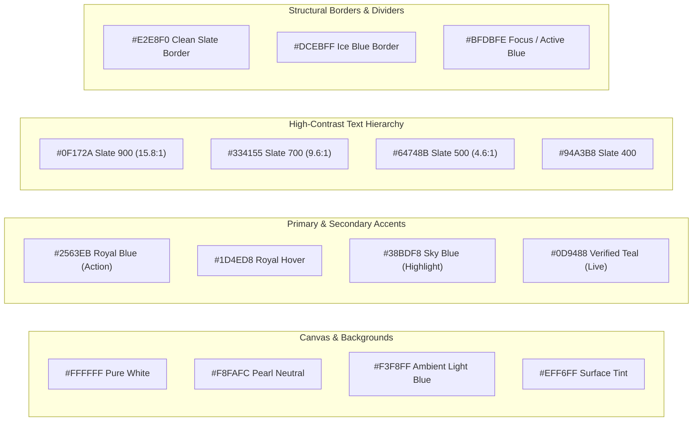

# DESIGN_SYSTEM.md — Luxury Light-Theme Design System & Visual Specification

**Project:** Ravi Dasari — Premium Dynamic Personal Portfolio  
**Target Domain:** `ravi-portfolio.dsecops88.online`  
**Current Milestone:** Prompt 03 of 18 (UI/UX Design System)  
**Aesthetic Governance:** Pure Light Theme Only (Strict Invariant)  

---

## 1. Brand Identity & Visual Philosophy

The visual identity of Ravi Dasari’s portfolio is calibrated for **executive-level technical authority, architectural rigor, and engineering trust**. It is designed to impress international recruiters, enterprise engineering leaders, and client executives.

### Core Visual Principles
1. **Pristine Clarity & Luminosity:** An uncompromising light-only canvas utilizing pearl white, soft atmospheric blue tints, and crisp structural borders.
2. **Architectural Restraint:** Clean geometric typography, generous white space, subtle glassmorphic layers, and zero chaotic visual noise.
3. **Intentional Contrast & Hierarchy:** Slate-900 typography paired with Royal Blue and Cyan accents ensures WCAG 2.2 AA/AAA readability while feeling vibrant and modern.
4. **Dynamic Elegance:** Subtle micro-interactions, responsive physics, and refined shadows elevate the UI beyond standard resume templates into an executive software product.

---

## 2. Master Color Palette & Token Definitions

### 2.1 Prohibited Palette (Strict Zero-Tolerance Invariant)
* **FORBIDDEN:** Black backgrounds (`#000000`), Dark Slate/Navy backgrounds (`#0F172A`, `#1E293B`, `#0B132B`), dark cards, dark footer/hero sections, dark gradients, or dark-mode toggles anywhere across the public site or admin dashboard.

### 2.2 Approved Color Tokens



| Token Name | Hex Value | Usage / Role | WCAG Contrast on `#FFFFFF` |
| :--- | :--- | :--- | :--- |
| `color-bg-canvas` | `#FFFFFF` | Primary viewport background | — |
| `color-bg-subtle` | `#F8FAFC` | Section alternating background | — |
| `color-bg-ambient` | `#F3F8FF` | Hero aura, interactive card fills | — |
| `color-surface-card`| `#FFFFFF` | Elevated cards, modals, popovers | — |
| `color-surface-secondary` | `#EFF6FF` | Code blocks, pill badges, active tabs | — |
| `color-surface-glass` | `rgba(255, 255, 255, 0.85)` | Sticky header, backdrop blur filters | — |
| `color-border-subtle` | `#E2E8F0` | Default card and section borders | 1.2:1 (Structural) |
| `color-border-accent` | `#DCEBFF` | Highlighted borders, card outlines | 1.3:1 (Structural) |
| `color-border-focus` | `#2563EB` | Active inputs, selected cards, focus rings | 4.6:1 (3:1 required for UI) |
| `color-brand-primary` | `#2563EB` | Primary CTA buttons, link text, active indicators | 4.6:1 (Passes AA normal text) |
| `color-brand-hover` | `#1D4ED8` | Primary CTA hover state | 6.4:1 (Passes AAA normal text) |
| `color-brand-secondary` | `#38BDF8` | Sky blue gradients, badge highlights | Decorative / Accents |
| `color-brand-teal` | `#0D9488` | "Verified Live" badge, published status | 4.5:1 (Passes AA) |
| `color-status-success` | `#059669` | Success banners, test passed tags | 4.6:1 (Passes AA) |
| `color-status-warning` | `#D97706` | "Prototype", "In Development" tags | 4.5:1 (Passes AA) |
| `color-status-info` | `#4F46E5` | "Planned Capability", info notifications | 5.8:1 (Passes AAA) |
| `color-status-danger` | `#DC2626` | Delete confirmations, validation errors | 4.8:1 (Passes AA) |
| `color-text-primary` | `#0F172A` | Headings, hero display, button labels | **15.8:1 (Exceptional AAA)** |
| `color-text-body` | `#334155` | Body copy, case studies, descriptions | **9.6:1 (Exceptional AAA)** |
| `color-text-muted` | `#64748B` | Captions, dates, secondary metadata | **4.6:1 (Passes AA)** |
| `color-text-inverted` | `#FFFFFF` | Text on Royal Blue / Teal buttons | 4.6:1 on `#2563EB` |

---

## 3. Typography System

The typography scale utilizes **Plus Jakarta Sans** for commanding, executive display headings and **Inter** for dense, readable UI components and technical case-study prose. **JetBrains Mono** provides crisp formatting for code, pipeline commands, and terminal badges.

### 3.1 Typeface Hierarchy
* **Primary Display & Headings:** `Plus Jakarta Sans`, `-apple-system, BlinkMacSystemFont, "Segoe UI", Roboto, sans-serif`
* **Body, UI, & Forms:** `Inter`, `-apple-system, BlinkMacSystemFont, "Segoe UI", Roboto, sans-serif`
* **Code, DevOps Configs & Monospace:** `JetBrains Mono`, `ui-monospace, SFMono-Regular, Menlo, monospace`

### 3.2 Responsive Type Scale

| Level | Size (Desktop) | Size (Mobile) | Line Height | Weight | Letter Spacing | Font Family |
| :--- | :--- | :--- | :--- | :--- | :--- | :--- |
| **Display Hero** | `3.75rem` (60px) | `2.5rem` (40px) | 1.1 | 800 (ExtraBold) | `-0.03em` | Plus Jakarta Sans |
| **Heading 1** | `2.75rem` (44px) | `2.0rem` (32px) | 1.2 | 700 (Bold) | `-0.025em` | Plus Jakarta Sans |
| **Heading 2** | `2.0rem` (32px) | `1.5rem` (24px) | 1.25 | 700 (Bold) | `-0.02em` | Plus Jakarta Sans |
| **Heading 3** | `1.375rem` (22px) | `1.25rem` (20px) | 1.35 | 600 (SemiBold) | `-0.015em` | Plus Jakarta Sans |
| **Heading 4** | `1.125rem` (18px) | `1.0625rem` (17px)| 1.4 | 600 (SemiBold) | `-0.01em` | Plus Jakarta Sans |
| **Body Large** | `1.125rem` (18px) | `1.0rem` (16px) | 1.65 | 400 (Regular) | `0.0em` | Inter |
| **Body Base** | `1.0rem` (16px) | `0.9375rem` (15px)| 1.6 | 400 (Regular) | `0.0em` | Inter |
| **Body Small** | `0.875rem` (14px) | `0.8125rem` (13px)| 1.5 | 400 / 500 | `0.0em` | Inter |
| **Caption / Meta** | `0.75rem` (12px) | `0.75rem` (12px) | 1.4 | 500 (Medium) | `+0.01em` | Inter |
| **Tech Tag / Pill**| `0.75rem` (12px) | `0.6875rem` (11px)| 1.4 | 600 (SemiBold) | `+0.03em` | Inter / JetBrains Mono |
| **Code Snippet** | `0.875rem` (14px) | `0.8125rem` (13px)| 1.6 | 400 (Regular) | `0.0em` | JetBrains Mono |

---

## 4. Spacing, Layout & Grid System

All layouts adhere to an **8-point geometric spatial scale** (with 4-point half-steps for fine-grained alignments).

### 4.1 Spacing Tokens
* `space-1`: `4px` (`0.25rem`) — micro padding, icon gap
* `space-2`: `8px` (`0.5rem`) — badge padding, tight stack
* `space-3`: `12px` (`0.75rem`) — input field internal padding, tag spacing
* `space-4`: `16px` (`1.0rem`) — standard card inner padding, grid gap
* `space-6`: `24px` (`1.5rem`) — large card padding, section sub-elements
* `space-8`: `32px` (`2.0rem`) — desktop card padding, component separation
* `space-12`: `48px` (`3.0rem`) — section intra-spacing, hero gutters
* `space-16`: `64px` (`4.0rem`) — standard section padding (mobile)
* `space-24`: `96px` (`6.0rem`) — standard section padding (desktop)
* `space-32`: `128px` (`8.0rem`) — hero vertical padding

### 4.2 Breakpoints & Containers
* **Max Width (Global):** `1280px` (`max-w-7xl`) centered with responsive inline padding (`px-4 sm:px-6 lg:px-8`).
* **Reading Width (Case Studies / Bio):** `768px` (`max-w-3xl`) for optimal typographical eye-tracking.
* **Breakpoints:**
  - `xs`: `320px` (Compact Mobile)
  - `sm`: `640px` (Large Mobile)
  - `md`: `768px` (Tablet / Foldable)
  - `lg`: `1024px` (Laptop / Small Desktop)
  - `xl`: `1280px` (Standard Desktop)
  - `2xl`: `1536px` (Ultra-wide Desktop)

---

## 5. Elevation, Shadows & Glassmorphic Accents

Shadows are exclusively cast with light, multi-layered ambient occlusions tinted with subtle royal blue, eliminating dirty or muddy dark drops.

```css
/* Custom Light-Theme Elevation Tokens */
--shadow-subtle: 0 1px 2px 0 rgba(15, 23, 42, 0.04), 0 1px 3px 0 rgba(37, 99, 235, 0.03);
--shadow-card: 0 4px 6px -1px rgba(15, 23, 42, 0.05), 0 2px 4px -2px rgba(37, 99, 235, 0.04);
--shadow-card-hover: 0 14px 28px -4px rgba(37, 99, 235, 0.09), 0 6px 12px -2px rgba(15, 23, 42, 0.03);
--shadow-floating: 0 20px 32px -6px rgba(37, 99, 235, 0.12), 0 8px 16px -4px rgba(15, 23, 42, 0.05);

/* Glassmorphic Layering */
--glass-bg: rgba(255, 255, 255, 0.82);
--glass-border: 1px solid rgba(220, 235, 255, 0.8);
--glass-blur: blur(14px);
```

---

## 6. Border Radius Scale
* `radius-sm`: `6px` (`0.375rem`) — Badges, tags, tooltips.
* `radius-md`: `10px` (`0.625rem`) — Form inputs, buttons, dropdown menus.
* `radius-lg`: `16px` (`1.0rem`) — Project cards, skill groups, modals.
* `radius-xl`: `24px` (`1.5rem`) — Hero card, large architecture diagrams.
* `radius-full`: `9999px` — Avatars, pill badges, floating action buttons.

---

## 7. Accessibility & Focus States
* **Focus Ring Standard:** Every interactive element (links, buttons, inputs, tabs) displays a prominent, high-contrast focus indicator:
  `outline: 2px solid #2563EB; outline-offset: 3px;`
* **Contrast Guarantee:** 100% of body text meets or exceeds WCAG 2.2 AA (minimum 4.5:1), with primary copy achieving AAA (15.8:1).
* **Motion Guard:** All animated components strictly respect `prefers-reduced-motion: reduce`.

