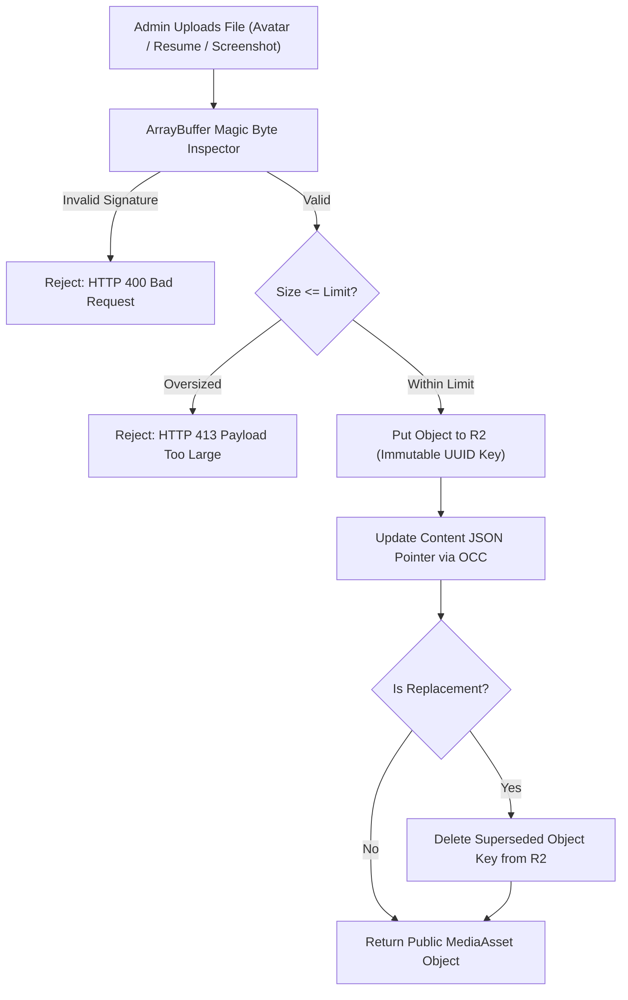

# MEDIA_LIFECYCLE.md — Media Storage, Verification & Lifecycle Protocols

**Project:** Ravi Dasari — Premium Dynamic Personal Portfolio  
**Target Domain:** `ravi-portfolio.dsecops88.online`  
**Current Milestone:** Prompt 04 of 18 (Storage & Runtime Architecture)  
**Storage Tier:** Cloudflare R2 Standard Object Storage  

---

## 1. Media Asset Architecture & Key Naming Standards

All media files are stored in Cloudflare R2 under deterministic, immutable keys incorporating cryptographic UUIDs. Using versioned, immutable keys guarantees that browser and CDN caches **never serve stale images** after an asset is replaced.



### 1.1 Object Key Convention Matrix

| Asset Category | Storage Path Pattern | Max Size | Allowed Formats | Cache Header |
| :--- | :--- | :--- | :--- | :--- |
| **Profile Photo** | `media/avatars/avatar-${uuid}.webp` | 5 MB | WebP, PNG, JPEG | `public, max-age=31536000, immutable` |
| **Active Resume** | `media/resume/active/Ravi_Dasari_Resume.pdf` | 10 MB | Strictly PDF (`%PDF-`) | `public, max-age=300, s-maxage=3600` |
| **Archived Resume**| `media/resume/archive/resume-${timestamp}-${uuid}.pdf` | 10 MB | Strictly PDF | `private, no-cache` |
| **Project Cover** | `media/projects/${slug}/cover-${uuid}.webp` | 5 MB | WebP, PNG, JPEG | `public, max-age=31536000, immutable` |
| **Screenshots** | `media/projects/${slug}/shot-${uuid}.webp` | 5 MB | WebP, PNG, JPEG | `public, max-age=31536000, immutable` |
| **Architecture** | `media/projects/${slug}/diag-${uuid}.webp` | 2 MB | WebP, PNG, SVG | `public, max-age=31536000, immutable` |
| **Certifications** | `media/certifications/cert-${uuid}.webp` | 2 MB | WebP, PNG, JPEG | `public, max-age=31536000, immutable` |

---

## 2. Server-Side Magic Byte Validation

To prevent malicious executable uploads disguised with fake extensions (e.g., `exploit.exe` renamed to `exploit.png`), the Cloudflare Worker inspects the first 16 bytes of the binary buffer prior to touching R2:

```typescript
export function validateMagicBytes(buffer: ArrayBuffer, declaredMime: string): boolean {
  const bytes = new Uint8Array(buffer.slice(0, 16));

  // PDF Validation (%PDF- -> 0x25, 0x50, 0x44, 0x46, 0x2D)
  if (declaredMime === 'application/pdf') {
    return bytes[0] === 0x25 && bytes[1] === 0x50 && bytes[2] === 0x44 && bytes[3] === 0x46 && bytes[4] === 0x2D;
  }

  // PNG Validation (0x89, 0x50, 0x4E, 0x47, 0x0D, 0x0A, 0x1A, 0x0A)
  if (declaredMime === 'image/png') {
    return bytes[0] === 0x89 && bytes[1] === 0x50 && bytes[2] === 0x4E && bytes[3] === 0x47;
  }

  // JPEG Validation (0xFF, 0xD8, 0xFF)
  if (declaredMime === 'image/jpeg') {
    return bytes[0] === 0xFF && bytes[1] === 0xD8 && bytes[2] === 0xFF;
  }

  // WebP Validation (RIFF....WEBP -> 0x52, 0x49, 0x46, 0x46 ... 0x57, 0x45, 0x42, 0x50)
  if (declaredMime === 'image/webp') {
    return bytes[0] === 0x52 && bytes[1] === 0x49 && bytes[2] === 0x46 && bytes[3] === 0x46 &&
           bytes[8] === 0x57 && bytes[9] === 0x45 && bytes[10] === 0x42 && bytes[11] === 0x50;
  }

  return false;
}
```

### 2.1 SVG Sanitization Policy
If an SVG diagram is uploaded:
* The buffer is decoded as UTF-8 XML.
* The Worker strictly rejects the file if it contains `<script>`, `<foreignObject>`, or inline JavaScript event attributes (`onload`, `onclick`, `onerror`).

### 2.2 Resume Format Policy: DOCX Prohibition
* **Evaluation:** Microsoft Word (`.docx`) files cannot be natively rendered in web viewports, introduce formatting discrepancies across different Office/LibreOffice installations, and pose macro malware risks.
* **Architectural Decision:** Strictly **PDF Only** for public downloads and in-browser preview. If the owner maintains an editable `.docx` locally, they must export to PDF before publishing via the Admin CMS.

---

## 3. Profile Photo Lifecycle Specification

The profile avatar follows a strict 5-stage lifecycle:

```
[Select Photo] -> [Client-side 1:1 Crop Preview] -> [Magic Byte Verification]
       |
       v
[Put to R2: media/avatars/avatar-${uuid}.webp]
       |
       v
[Update profile.json avatar pointer via OCC]
       |
       +---> [Delete previous avatar key from R2]
       |
       +---> [Purge /api/public/content Edge Cache]
       |
       v
[Public Hero renders new avatar immediately]
```

### Fallback Avatar Specification
When `profile.avatar` is `null` (after deletion or before initial upload):
* The public frontend renders an ultra-crisp, executive SVG monogram featuring `RD` in royal blue on a soft pearl background (`#EFF6FF`), ensuring zero broken image icons or layout shifts.

---

## 4. Resume Lifecycle Specification

The resume lifecycle ensures that public visitors and recruiters always receive the latest published PDF without stale cache issues:

1. **Upload & Ingest:** Admin uploads `Ravi_Dasari_Resume.pdf`. Worker validates `%PDF-` signature and enforces `<= 10 MB`.
2. **Archive Old File:** If an active resume exists, it is moved to `media/resume/archive/resume-${timestamp}-${uuid}.pdf` and recorded in `resume.auditHistory`.
3. **Write Active Object:** The new file is written to `media/resume/active/Ravi_Dasari_Resume.pdf`.
4. **Update State:** `content/resume.json` is updated with new file size, upload timestamp, and version tag (`v2026.1`).
5. **Public Download Stream:** `GET /api/public/resume/download` streams the PDF with `Content-Disposition: attachment; filename="Ravi_Dasari_Resume.pdf"` and short edge cache headers (`max-age=300, s-maxage=3600, stale-while-revalidate=60`).
6. **Unpublish / Delete:** If the admin clicks "Unpublish" or "Delete", `resume.published` is set to `false`. Subsequent calls to the public download route return `HTTP 404 Not Found`, and the public hero resume CTA button gracefully disables itself.

---

## 5. Orphan Asset Garbage Collection

To prevent R2 storage bloat from accumulated unused media:
1. **Immediate Inline Deletion:** When replacing an avatar, project cover, or screenshot, the Worker immediately issues `R2.delete(oldKey)`.
2. **Cascade Project Deletion:** When a project is deleted via `DELETE /api/admin/projects/:id`, the Worker parses its `coverImage`, `diagram`, and `screenshots` arrays and deletes all associated keys from R2 before deleting the JSON record.
3. **Orphan Audit Script:** A maintenance endpoint (`POST /api/admin/media/cleanup-audit`) compares all keys under `media/` against references in active JSON content and reports any unreferenced objects for owner-approved batch purging.

