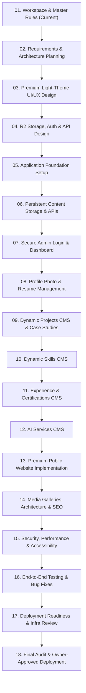

# PROJECT_ROADMAP.md — 18-Prompt Master Delivery Roadmap

**Project:** Ravi Dasari — Premium Dynamic Personal Portfolio  
**Domain:** `ravi-portfolio.dsecops88.online`  
**Current Milestone:** Prompt 01 of 18

---

## Roadmap Overview

This roadmap defines the sequential, disciplined delivery of the Ravi Dasari Portfolio. Each prompt represents an isolated, testable, and reviewable phase. Moving to the next prompt requires owner review and sign-off.

---

## Detailed Prompt Breakdown

### Prompt 01: Workspace Initialization and Master Project Rules (IN PROGRESS)
- **Objective:** Establish isolated workspace, inspect environment, create core documentation and governance contracts.
- **Key Deliverables:** `AGENTS.md`, `docs/PROJECT_REQUIREMENTS.md`, `docs/PROJECT_ROADMAP.md`, `docs/ARCHITECTURE_DECISIONS.md`, `docs/PROJECT_STATUS.md`.
- **Exit Criteria:** Clean workspace inspection, all 5 core documentation files created and validated, zero code or infrastructure changes executed, await owner approval.

### Prompt 02: Requirements and Architecture Planning
- **Objective:** Deep dive into system architecture, state machines, R2 storage models, data schemas, API contracts, and concurrency mechanisms.
- **Key Deliverables:** JSON Schema specifications for all portfolio entities, write-conflict mitigation strategies, backup/restore flowcharts, auth state design.
- **Exit Criteria:** Architectural decisions signed off; tech stack decisions confirmed.

### Prompt 03: Premium Light-Theme UI/UX Design System
- **Objective:** Define exact visual design tokens, component library, typography scale, palette variables, glassmorphic styles, and responsive layout specifications.
- **Key Deliverables:** CSS design system tokens, color scale variables, component state mockups, accessibility contrast audit.
- **Exit Criteria:** UI tokens validated against Light-Theme-Only rules (zero dark mode leaks).

### Prompt 04: R2 Storage, Authentication and API Design
- **Objective:** Architect the R2 bucket directory structure, metadata headers, pre-signed / worker-routed upload strategies, authentication protocols, and REST API definitions.
- **Key Deliverables:** OpenAPI/REST endpoint specifications, R2 key hierarchy specification, token lifecycle definition, orphan cleanup algorithm.
- **Exit Criteria:** Storage and security architecture fully documented and vetted.

### Prompt 05: Application Foundation
- **Objective:** Initialize the project framework (Next.js / Cloudflare Worker full-stack runtime), configure Tailwind CSS with light-only tokens, setup TypeScript configurations, and verify dev server baseline.
- **Key Deliverables:** Initialized repository scaffold, type definitions, base layout, and build scripts.
- **Exit Criteria:** Clean local build with zero errors, zero warnings.

### Prompt 06: Persistent Content Storage and APIs
- **Objective:** Implement server-side content reading and writing routines interfacing with R2 (or simulated local storage for offline development), including versioning and optimistic locking.
- **Key Deliverables:** Core CRUD storage service, JSON validation layer (Zod schemas), snapshot backup handler, mutation test suite.
- **Exit Criteria:** Read and write API endpoints passing automated unit and integration tests.

### Prompt 07: Secure Admin Login and Dashboard
- **Objective:** Implement owner authentication system, secure session management, protected admin routing, and main CMS dashboard navigation.
- **Key Deliverables:** Login page, session verification middleware, admin shell layout, security headers, rate-limiting handlers.
- **Exit Criteria:** Secure login flow verified; unauthenticated access prevented with zero bypass vectors.

### Prompt 08: Profile Photo and Resume Management
- **Objective:** Build CMS interfaces and edge handlers for updating profile information, uploading/cropping profile photos to R2, and uploading/previewing/replacing the PDF resume.
- **Key Deliverables:** Profile editor form, R2 image uploader with preview, PDF resume uploader and in-app viewer, old asset deletion handlers.
- **Exit Criteria:** Photo and resume upload, replace, and deletion tested end-to-end.

### Prompt 09: Dynamic Projects CMS and Case Studies
- **Objective:** Build the project management CMS module supporting unlimited projects, markdown case studies, tag management, media gallery uploader, and ordering.
- **Key Deliverables:** Project creation/edit forms, drag-and-drop ordering, case study editor, screenshots uploader, published/draft status toggle.
- **Exit Criteria:** Projects can be added, modified, reordered, and deleted dynamically.

### Prompt 10: Dynamic Skills CMS
- **Objective:** Build the skills management CMS module allowing categorized skill creation, proficiency indicators, category organization, and reordering.
- **Key Deliverables:** Skill category manager, skill item editor, reorder controls, live preview component.
- **Exit Criteria:** Dynamic skills updates instantly reflected in preview.

### Prompt 11: Experience and Certifications CMS
- **Objective:** Build CMS management modules for chronological work experience and verified professional certifications.
- **Key Deliverables:** Experience timeline editor, certification badge uploader, credential link validator.
- **Exit Criteria:** Experience and certification records safely created, edited, and ordered.

### Prompt 12: AI Services CMS
- **Objective:** Build CMS management for AI agents, voice assistants, calling pipelines, and automation services with mandatory four-state status tagging.
- **Key Deliverables:** AI service manager, status tag selector (`Live`, `Prototype`, `Development`, `Planned`), tooling badges.
- **Exit Criteria:** AI capabilities accurately managed and tagged.

### Prompt 13: Premium Public Website Implementation
- **Objective:** Assemble the eleven (11) high-performance public website sections, connecting them to the dynamic content API.
- **Key Deliverables:** Hero, About, Skills, Experience, Enterprise Projects, Featured Projects (RoboShop, Zynpath, Mandi Ledger, NEXORA), AI Showcase, Architecture, Certifications, Resume Download, Contact.
- **Exit Criteria:** Flawless light-only design, responsive layout, dynamic data hydration.

### Prompt 14: Media Galleries, Architecture and SEO
- **Objective:** Implement interactive architecture diagram viewers, project screenshot modals, dynamic Open Graph / Twitter Card metadata generation, sitemap.xml, and robots.txt.
- **Key Deliverables:** Architecture zoom/pan modal, responsive image lightbox, SEO dynamic tags, JSON-LD structured data.
- **Exit Criteria:** SEO and social share previews render correctly with 100% valid schema markup.

### Prompt 15: Security, Performance and Accessibility
- **Objective:** Deep security audit, CSP configuration, Cloudflare Turnstile anti-spam integration, image optimization, Lighthouse audits, and WCAG AA verification.
- **Key Deliverables:** Security headers, optimized assets, Lighthouse 98+ scores across all metrics, accessibility report.
- **Exit Criteria:** Zero security vulnerabilities, zero accessibility errors.

### Prompt 16: End-to-End Testing and Bug Fixes
- **Objective:** Execute exhaustive automated and manual testing across all admin workflows and public pages on multiple viewport sizes.
- **Key Deliverables:** E2E test runs (Playwright/Cypress), mobile testing verification, cross-browser compatibility report, bug fix log.
- **Exit Criteria:** All user journeys pass without errors.

### Prompt 17: Deployment Readiness and Infrastructure Review
- **Objective:** Prepare Cloudflare deployment configuration (`wrangler.toml`), create Cloudflare resource provisioning plans (Workers, R2 bucket bindings, environment secrets), and dry-run build.
- **Key Deliverables:** Production build bundle, infrastructure provisioning checklist, environment variable audit.
- **Exit Criteria:** Production build succeeds locally; zero uncommitted or unverified variables.

### Prompt 18: Final Audit and Owner-Approved Deployment
- **Objective:** Conduct pre-flight security review with owner, configure custom domain `ravi-portfolio.dsecops88.online`, bind R2 storage, deploy to Cloudflare edge, and perform live verification.
- **Key Deliverables:** Live production deployment at `ravi-portfolio.dsecops88.online`, verified Admin CMS in production, post-deployment smoke test report.
- **Exit Criteria:** Owner signs off on live website.

