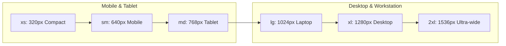

# RESPONSIVE_AND_MOTION_SPEC.md — Responsive Layout & Motion Physics

**Project:** Ravi Dasari — Premium Dynamic Personal Portfolio  
**Target Domain:** `ravi-portfolio.dsecops88.online`  
**Current Milestone:** Prompt 03 of 18 (UI/UX Design System)  
**Performance Guarantee:** 60fps GPU-Accelerated Animations | Zero Layout Shifts  

---

## 1. Responsive Viewport Grid & Breakpoint Matrix

The layout adapts fluidly from ultra-compact smartphones (320px) to 4K ultra-wide workstations (2560px), guaranteeing **zero horizontal overflow** (`overflow-x: hidden`) at all times.



### Detailed Breakpoint Specifications

| Breakpoint | Viewport Width | Public Layout Behavior | Admin CMS Behavior | Touch Target Policy |
| :--- | :--- | :--- | :--- | :--- |
| **`xs` (Compact Mobile)** | `320px - 639px` | 1-column stack; sticky header with hamburger drawer; hero image stacks below headline; 1-column project cards. | Sidebar collapses to full-screen drawer; form actions sticky at screen bottom. | Minimum `48px x 48px` tap targets. |
| **`sm` (Large Mobile)** | `640px - 767px` | 1-column stack with relaxed gutters (`px-6`); 2-column skills grid; metric pills in 2x2 grid. | Forms display in comfortable single-column layout; modal dialogs occupy 92% width. | Minimum `44px x 44px` tap targets. |
| **`md` (Tablet / Foldable)**| `768px - 1023px`| 2-column project cards; hero renders side-by-side with 40% photo / 60% text; 3-column skills grid. | Sidebar collapses to icon rail or slide-over drawer; table rows wrap into cards. | Touch + Pointer hybrid support. |
| **`lg` (Laptop / Small Desk)**| `1024px - 1279px`| Full horizontal navigation bar; 2-column featured projects; case studies feature sticky sidebar. | Persistent 240px left navigation sidebar; multi-column form layouts active. | Standard pointer hover states. |
| **`xl` (Standard Desktop)** | `1280px - 1535px`| Maximum container width `1280px` (`max-w-7xl`); 3-column project grids; 4-column skill grids. | Expanded 260px sidebar with full status indicators; side-by-side case-study preview. | Full desktop experience. |
| **`2xl` (Ultra-wide)** | `>= 1536px` | Centered layout with generous whitespace; reading columns clamped at `768px` (`max-w-3xl`). | Centered admin container; increased table density. | Full desktop experience. |

---

## 2. Motion Physics & Animation Tokens

Animations are deliberately understated, crisp, and high-performance, reinforcing an executive software aesthetic rather than a flashy consumer site.

### 2.1 Timing & Easing Curves
```css
/* Duration Tokens */
--duration-fast: 150ms;      /* Tooltips, button taps, micro toggles */
--duration-normal: 250ms;    /* Card hovers, tab switches, dropdowns */
--duration-slow: 400ms;      /* Modal entrances, mobile drawer slide */

/* Mathematical Easing Curves */
--ease-out: cubic-bezier(0, 0, 0.2, 1);       /* Element entrance */
--ease-in-out: cubic-bezier(0.4, 0, 0.2, 1);   /* State transitions */
--ease-spring: cubic-bezier(0.16, 1, 0.3, 1);  /* Micro-interactions & dialogs */
```

### 2.2 Micro-Interactions Catalog
1. **Interactive Cards (Projects, Skills, AI Services):**
   - **Default:** `border: 1px solid #E2E8F0; box-shadow: var(--shadow-card); transform: translateY(0);`
   - **Hover:** `border-color: #BFDBFE; box-shadow: var(--shadow-card-hover); transform: translateY(-3px);`
   - **Transition:** `all 250ms var(--ease-spring)`
2. **Primary Action Buttons:**
   - **Default:** `background: #2563EB; transform: scale(1);`
   - **Hover:** `background: #1D4ED8; transform: translateY(-1px); box-shadow: 0 4px 12px rgba(37, 99, 235, 0.25);`
   - **Active / Tap:** `transform: scale(0.98); box-shadow: none;`
3. **Sticky Navigation Transition:**
   - At scroll > 20px: Transitions smoothly from transparent to `rgba(255, 255, 255, 0.85)` with `backdrop-filter: blur(14px)` and `#DCEBFF` bottom border over 200ms.
4. **Modal & Lightbox Entrances:**
   - Backdrop fades in: `opacity: 0 -> 1` over 200ms.
   - Content container enters: `opacity: 0 -> 1; transform: scale(0.96) -> scale(1.0)` over 250ms `var(--ease-spring)`.

---

## 3. Strict Performance & Battery Safeguards

* **Composite Layers Only:** Animations are strictly limited to `transform` and `opacity`. Properties that trigger browser layout recalculations (`width`, `height`, `margin`, `padding`, `top`, `left`) are **never animated**.
* **Zero Heavy 3D Loops:** No continuous WebGL canvas loops or three.js scenes that deplete mobile battery or cause frame drops.
* **Hardware Acceleration:** All animated surfaces utilize `will-change: transform` only during active transitions to prevent VRAM memory bloat.

---

## 4. Accessibility & Reduced Motion Specification

The system fully honors the user's operating system preferences for reduced motion:

```css
@media (prefers-reduced-motion: reduce) {
  *,
  *::before,
  *::after {
    animation-duration: 0.01ms !important;
    animation-iteration-count: 1 !important;
    transition-duration: 0.01ms !important;
    scroll-behavior: auto !important;
  }
}
```

* **When Reduced Motion is Enabled:**
  - All sliding drawers and transform lifts collapse to instantaneous cuts or subtle 100ms opacity fades.
  - Smooth scrolling is disabled in favor of instant jump navigation.
  - Interactive diagram panning remains functional via manual click-and-drag.

