# SECURITY_ARCHITECTURE.md — Zero-Trust DevSecOps & Security Specification

**Project:** Ravi Dasari — Premium Dynamic Personal Portfolio  
**Target Domain:** `ravi-portfolio.dsecops88.online`  
**Current Milestone:** Prompt 02 of 18 (System Architecture Planning)  

---

## 1. Security Philosophy & Threat Model

The portfolio operates on **Zero-Trust principles**. The public portfolio is entirely decoupled from the administrative control plane. No administrative credentials, raw R2 access keys, or mutation permissions are ever exposed to the public internet or client browsers.

```mermaid
graph LR
    subgraph PublicInternet ["Untrusted Public Internet"]
        Attacker["Potential Threat Actor / Bot"]
        LegitUser["Legitimate Visitor"]
    end

    subgraph DefenseInDepth ["Cloudflare Edge Defense Layers"]
        WAF["Cloudflare Edge WAF & DDoS Shield"]
        Turnstile["Cloudflare Turnstile (Anti-Bot)"]
        RateLimit["Edge Rate Limiter (Login: 5/15min, Contact: 5/hr)"]
    end

    subgraph WorkerRuntime ["Cloudflare Worker Security Boundary"]
        OriginCheck["Origin & Referer Enforcer"]
        SessionValidator["HMAC-SHA256 Cookie Session Validator"]
        MagicByteValidator["MIME Magic Byte & Size Inspector"]
        ZodValidator["Strict Zod Schema Validator"]
        Sanitizer["XSS / Markdown Sanitizer (DOMPurify)"]
    end

    subgraph StorageBoundary ["Storage & Secret Boundary"]
        R2["Cloudflare R2 Bucket (Private Binding)"]
        Secrets["Encrypted Worker Secrets (KMS)"]
    end

    Attacker -.->|DDoS / Brute Force| WAF
    WAF -.->|Blocked| Attacker
    LegitUser --> WAF
    WAF --> Turnstile
    Turnstile --> RateLimit
    RateLimit --> OriginCheck
    OriginCheck --> SessionValidator
    SessionValidator --> MagicByteValidator
    MagicByteValidator --> ZodValidator
    ZodValidator --> Sanitizer
    Sanitizer --> R2
    SessionValidator -.->|Verify Signature| Secrets
```



---

## 2. Admin Authentication Strategy Evaluation

We evaluated two enterprise architectures for protecting the single-owner Admin CMS:

### Option A: Cloudflare Zero Trust Access (Cloudflare Access)
* **Mechanism:** Cloudflare proxies requests to `/admin*` and `/api/admin*` through Cloudflare Access, requiring one-time pin (OTP) via email or Google Workspace login.
* **Pros:** Enterprise-grade identity federation, IP whitelisting, zero auth code needed in the application.
* **Cons:** Requires configuring Cloudflare Zero Trust organization, potential lock-out if email delivery is delayed, requires external Cloudflare dashboard setup before local testing.

### Option B: Standalone Edge Auth (HMAC-SHA256 Signed Session Cookies)
* **Mechanism:** Cloudflare Worker natively handles `/api/admin/auth/login`. Password verified via Web Crypto PBKDF2 with 100,000 rounds. Issues an encrypted/signed session cookie.
* **Pros:** 100% self-contained in the Worker, works seamlessly in local development (`wrangler dev`), zero external dependencies, zero recurring subscription cost.
* **Cons:** Requires implementing secure session cookie handling in Worker code.

### Architectural Decision:
**Hybrid Defense-in-Depth Approach (Selected):**
1. **Primary Application Layer:** Implement **Option B (Standalone Edge Auth)** natively in the Cloudflare Worker. This ensures the application is completely secure out of the box in all environments (local, staging, production).
2. **Optional Edge Layer:** The owner can optionally overlay **Option A (Cloudflare Access)** in the Cloudflare dashboard to require email OTP before reaching the login screen, creating two-factor physical defense.

---

## 3. Session Management & Cryptographic Standards

* **Cookie Specifications:**
  - Name: `portfolio_admin_session`
  - Flags: `HttpOnly; Secure; SameSite=Strict; Path=/; Max-Age=1209600` (14 days)
* **Cryptographic Token Construction:**
  - Signature Algorithm: `HMAC-SHA256` executed via native Web Crypto API (`crypto.subtle`).
  - Payload Structure:
    ```json
    {
      "sub": "ravi-dasari",
      "role": "owner",
      "iat": 1730332800,
      "exp": 1731542400,
      "fingerprint": "<SHA-256 hash of User-Agent and IP subnet>"
    }
    ```
  - Verification: Every admin request recalculates the HMAC signature using the environment secret `SESSION_SECRET`. Expired or tampered cookies are instantly invalidated.

---

## 4. Protection Against Common Web Vulnerabilities

### 4.1 Cross-Site Request Forgery (CSRF)
* **Strict SameSite Cookies:** `SameSite=Strict` instructs modern browsers never to send the session cookie on cross-site link clicks or form submissions.
* **Custom Action Header Enforcement:** All state-changing mutations (`POST`, `PUT`, `DELETE`, `PATCH`) must include `X-Portfolio-Admin-Action: 1`. Cross-origin scripts cannot set custom headers without passing a CORS preflight check.
* **Origin / Referer Validation:** Worker middleware verifies that `Origin` exactly matches `https://ravi-portfolio.dsecops88.online` (or `http://localhost:8787` in dev).

### 4.2 Cross-Site Scripting (XSS) & Content Security Policy (CSP)
* **Zero Raw HTML Injection:** React naturally escapes all string inputs during DOM reconciliation.
* **Markdown Sanitization:** Project case studies written in markdown are parsed and scrubbed using strict sanitization rules:
  - Disallowed: `<script>`, `<iframe`, `<object>`, `<embed>`, inline event handlers (`onload`, `onclick`).
  - Links: Automatically assigned `rel="noopener noreferrer"` and checked against a strict protocol whitelist (`http:`, `https:` only).
* **Strict HTTP Security Headers:**
  ```http
  Content-Security-Policy: default-src 'self'; script-src 'self' 'unsafe-inline' https://challenges.cloudflare.com; style-src 'self' 'unsafe-inline' https://fonts.googleapis.com; font-src 'self' https://fonts.gstatic.com; img-src 'self' data: https://ravi-portfolio.dsecops88.online; frame-src https://challenges.cloudflare.com; connect-src 'self'; object-src 'none'; base-uri 'self';
  X-Frame-Options: DENY
  X-Content-Type-Options: nosniff
  Referrer-Policy: strict-origin-when-cross-origin
  Permissions-Policy: camera=(), microphone=(), geolocation=()
  ```

---

## 5. File Upload Verification & Anti-Malware Protocols

Any file uploaded to Cloudflare R2 undergoes strict multi-stage inspection:

1. **Size Constraints:**
   - Images (PNG, JPEG, WebP): Maximum **5 MB**.
   - Diagrams / Architecture SVGs: Maximum **2 MB**.
   - PDF Resume: Maximum **10 MB**.
2. **Magic Byte Inspection (True Content Verification):**
   The Worker reads the leading byte buffer and rejects files where the byte signature does not match:
   - **JPEG:** `FF D8 FF`
   - **PNG:** `89 50 4E 47 0D 0A 1A 0A`
   - **WebP:** `52 49 46 46` ... `57 45 42 50`
   - **PDF:** `25 50 44 46 2D` (`%PDF-`)
3. **SVG Sanitization:**
   - Raw SVGs are parsed as XML; if `<script>`, `<foreignObject>`, or `javascript:` attributes are detected, the file is rejected with `400 Bad Request`.
4. **Filename Normalization & Path Traversal Prevention:**
   - Uploaded files are stripped of original path separators (`../`, `..\`).
   - Files are saved under cryptographic UUID keys: `media/projects/${crypto.randomUUID()}-${cleanBasename}.webp`.

---

## 6. Rate Limiting & Secrets Management

### 6.1 Rate Limiting Architecture
* **Admin Login Route:** Strict threshold of **5 failed attempts per 15 minutes** per client IP. Exceeding triggers HTTP `429 Too Many Requests` with a retry delay.
* **Public Contact Route:** Maximum **5 submissions per hour** per IP, coupled with Cloudflare Turnstile bot detection.

### 6.2 Secrets Management Protocol
* **Zero Plaintext Secrets in Code:** Environment secrets are bound using Cloudflare encrypted secrets via Wrangler CLI:
  - `ADMIN_PASSWORD_HASH`: Salted PBKDF2 hash of owner password.
  - `SESSION_SECRET`: 256-bit cryptographic key for HMAC-SHA256 signing.
  - `TURNSTILE_SECRET_KEY`: Cloudflare Turnstile server validation secret.
* Secrets are injected into Worker execution contexts via Cloudflare KMS bindings and are never logged or returned in responses.

---

## 7. Audit Logging & Disaster Recovery

* **Immutable Audit Trail:**
  Every mutation on the admin plane logs a structured event:
  ```json
  {
    "timestamp": "2026-10-31T02:00:00.000Z",
    "event": "PROJECT_MUTATION",
    "action": "UPDATE_PROJECT",
    "targetId": "uuid-roboshop",
    "ipHash": "sha256(ip + salt)",
    "userAgent": "Mozilla/5.0 ...",
    "status": "SUCCESS"
  }
  ```
* **Disaster Recovery (R2 Snapshots):**
  - Prior to every save, the active JSON is copied to `backups/portfolio-data-${timestamp}-v${version}.json`.
  - Rolling retention keeps the last 50 backup snapshots in R2 Standard storage.
  - 1-click restore endpoint (`POST /api/admin/backups/:version/restore`) allows instant rollback.

