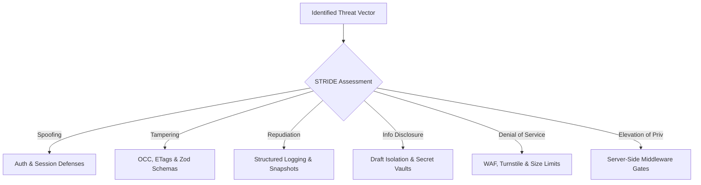

# SECURITY_THREAT_MODEL.md — Comprehensive Threat Model & Defense Specification

**Project:** Ravi Dasari — Premium Dynamic Personal Portfolio  
**Target Domain:** `ravi-portfolio.dsecops88.online`  
**Current Milestone:** Prompt 04 of 18 (Storage & Runtime Architecture)  
**Methodology:** STRIDE Threat Classification & OWASP ASVS Standards  

---

## 1. Threat Matrix Overview

Every threat vector across the public edge and administrative control plane is cataloged with preventative controls, runtime detection, and disaster recovery procedures.

---

## 2. Exhaustive STRIDE Threat Analysis

### 1. Unauthorized Admin Access / Brute Force
* **STRIDE Category:** Spoofing
* **Risk Level:** **HIGH**
* **Threat:** Automated bot attacks attempting dictionary or credential-stuffing attacks against `/api/admin/auth/login`.
* **Prevention:**
  - Salted PBKDF2 with 100,000 rounds renders offline brute forcing computationally infeasible.
  - Strict edge rate limiting: Maximum 5 failed attempts per 15 minutes per IP. Exceeding triggers HTTP 429.
  - Optional Cloudflare Access physical 2FA overlay (email OTP).
* **Detection:** Worker logs failed attempts with client IP hash and User-Agent.
* **Recovery:** Cloudflare WAF IP ban rule; emergency secret hash update via Wrangler CLI.

### 2. Session Theft & Replay
* **STRIDE Category:** Spoofing / Information Disclosure
* **Risk Level:** **HIGH**
* **Threat:** Stolen session cookie used from an unauthorized machine or IP address.
* **Prevention:**
  - Cookies strictly configured with `HttpOnly; Secure; SameSite=Strict; Path=/; Max-Age=1209600`.
  - Cryptographic token includes an IP subnet and User-Agent fingerprint hash in HMAC signature.
* **Detection:** Worker detects mismatch between token fingerprint and active request headers.
* **Recovery:** Immediate cookie expiration; rotating `SESSION_SECRET` globally revokes all active sessions.

### 3. Stored XSS (Cross-Site Scripting)
* **STRIDE Category:** Tampering
* **Risk Level:** **CRITICAL**
* **Threat:** Malicious JavaScript injected into a project case-study Markdown field or uploaded SVG diagram.
* **Prevention:**
  - React auto-escapes all string variables during DOM rendering.
  - Case-study Markdown is scrubbed with strict DOMPurify rules disallowing `<script>`, `<iframe>`, `<object>`, and inline event handlers (`onload`, `onerror`).
  - SVG uploads are inspected as XML; files with `<script>` or `<foreignObject>` tags are rejected with HTTP 400.
  - Strict Content Security Policy (CSP) with `script-src 'self' https://challenges.cloudflare.com; object-src 'none'`.
* **Detection:** Automated Zod schema validation regex filters; CSP violation reporting.
* **Recovery:** 1-click restore to pre-mutation snapshot via `/api/admin/backups/:id/restore`.

### 4. Cross-Site Request Forgery (CSRF)
* **STRIDE Category:** Tampering
* **Risk Level:** **HIGH**
* **Threat:** Third-party malicious website tricking an authenticated admin browser into mutating portfolio data.
* **Prevention:**
  - `SameSite=Strict` cookie policy prevents browsers from attaching credentials on cross-site links.
  - Mandatory custom header `X-Portfolio-Admin-Action: 1` enforced on all write routes.
  - Strict `Origin` header matching against `https://ravi-portfolio.dsecops88.online`.
* **Detection:** Worker returns HTTP 403 Forbidden on missing header or origin mismatch.

### 5. Malicious & Executable File Uploads
* **STRIDE Category:** Tampering / Elevation of Privilege
* **Risk Level:** **CRITICAL**
* **Threat:** Attacker uploads a web shell or executable disguised as an image (`shell.php` or `malware.exe` renamed to `photo.png`).
* **Prevention:**
  - Server-side ArrayBuffer magic byte inspection validates true file signatures (`%PDF-`, PNG, JPEG, WebP).
  - Uploaded files are stripped of extensions and saved as immutable UUIDs: `media/${uuid}.webp`.
  - Executable extensions (`.exe`, `.sh`, `.php`, `.bat`) are rejected immediately.
  - R2 objects are served with `Content-Type` strictly forced by the Worker, overriding client headers.
* **Detection:** Magic byte validator returns HTTP 400 Bad Request on format mismatch.

### 6. Storage Exhaustion / Denial of Wallet
* **STRIDE Category:** Denial of Service
* **Risk Level:** **MEDIUM**
* **Threat:** Uploading multi-gigabyte files to balloon R2 storage and billable operations.
* **Prevention:**
  - Strict size ceilings enforced in Worker before reading full request bodies:
    - Images: Max 5 MB.
    - PDF Resume: Max 10 MB.
    - SVG Diagrams: Max 2 MB.
  - Requests exceeding limits are terminated early with HTTP 413 Payload Too Large.
* **Detection:** R2 storage metrics monitored via Cloudflare dashboard alerts.

### 7. Public Exposure of Draft Projects
* **STRIDE Category:** Information Disclosure
* **Risk Level:** **HIGH**
* **Threat:** Unreleased projects, confidential client case studies, or unpublished skills leaked via public APIs or URLs.
* **Prevention:**
  - Server-side filtering on `GET /api/public/content` and `GET /api/public/projects` strips all items where `published !== true`.
  - Direct detail route `GET /api/public/projects/:slug` returns HTTP 404 Not Found if the project is a draft.
  - Media associated with draft projects includes `X-Robots-Tag: noindex`.
* **Detection:** Automated integration test suite tests draft isolation on every release.

### 8. Lost Updates & Write Collisions
* **STRIDE Category:** Tampering
* **Risk Level:** **MEDIUM**
* **Threat:** Concurrent edits from two browser tabs overwriting each other silently.
* **Prevention:**
  - Native R2 conditional writes using `If-Match: "<etag>"` preconditions.
  - Worker returns HTTP 409 Conflict if active state has advanced.
  - Automated snapshot backups captured prior to every write.
* **Detection:** Worker logs `CONCURRENCY_CONFLICT` event.

### 9. Contact Form Spam & Bot Abuse
* **STRIDE Category:** Denial of Service
* **Risk Level:** **MEDIUM**
* **Threat:** Automated bot networks spamming the inquiry form to flood Ravi's inbox.
* **Prevention:**
  - Cloudflare Turnstile bot verification required on all submissions.
  - Rate limiting of 5 submissions per hour per client IP.
* **Detection:** Turnstile siteverify API rejects invalid or automated challenge tokens.

