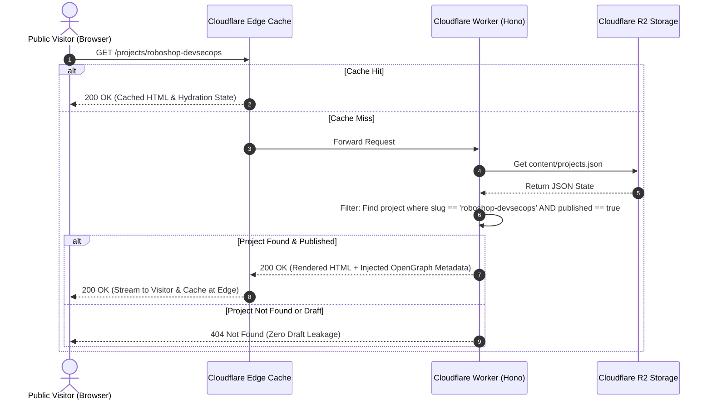
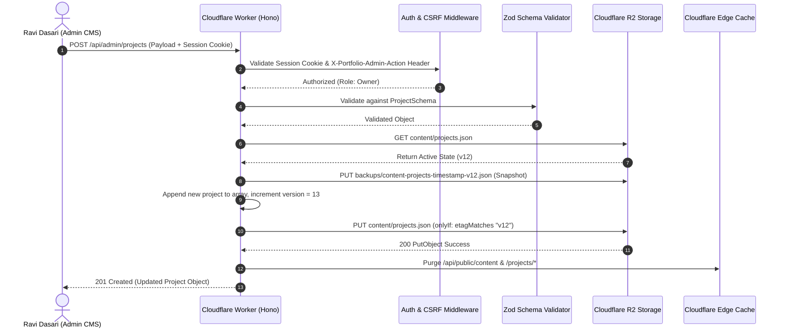
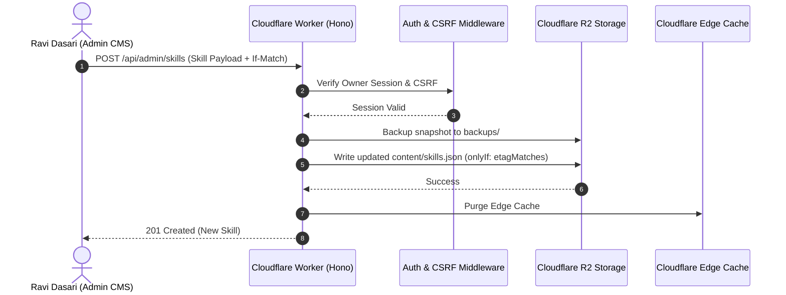
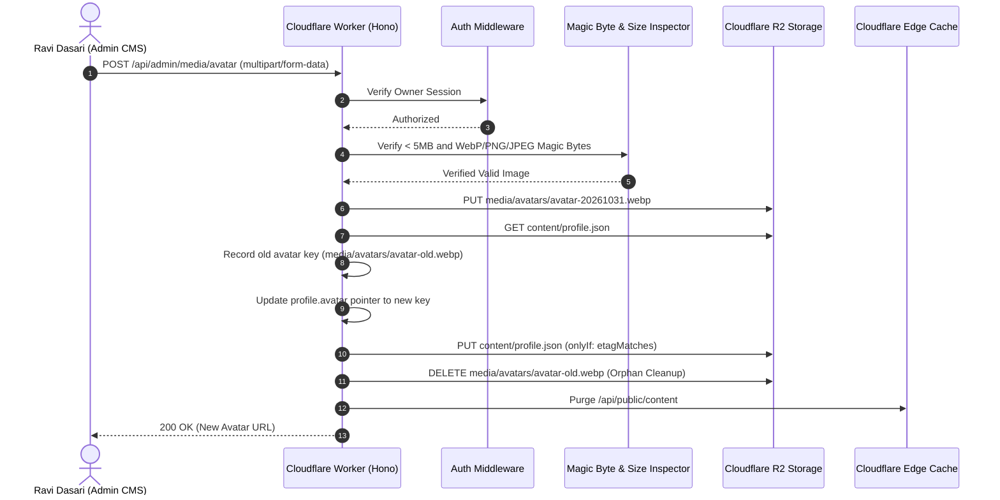
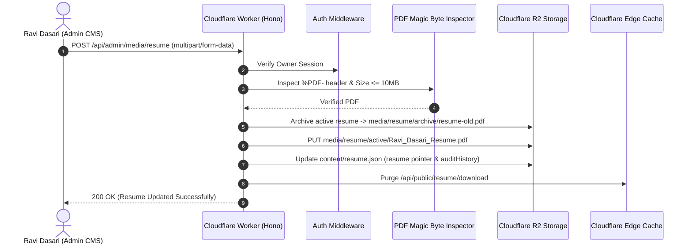
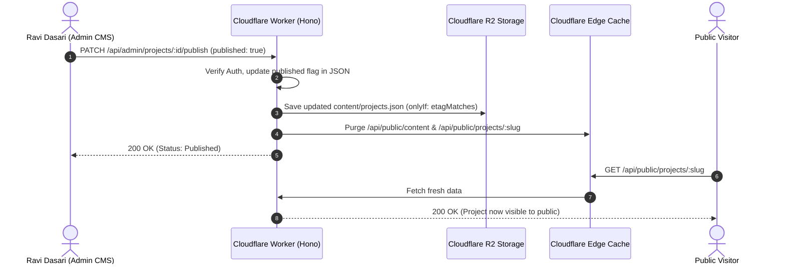

# TEST_STRATEGY.md — Quality Assurance, Verification & Data Flow Specification

**Project:** Ravi Dasari — Premium Dynamic Personal Portfolio  
**Target Domain:** `ravi-portfolio.dsecops88.online`  
**Current Milestone:** Prompt 04 of 18 (Storage & Runtime Architecture)  

---

## 1. Master Data Flow Diagrams

The following sequence diagrams illustrate the complete end-to-end data lifecycle across browser, API, authorization middleware, R2 persistent storage, and the public edge website.

### Flow A: Public Visitor Loading a Project


### Flow B: Admin Adding a New Project


### Flow C: Admin Adding a New Skill


### Flow D: Admin Uploading / Replacing Profile Photo


### Flow E: Admin Replacing Resume (PDF Only)


### Flow F: Admin Publishing / Unpublishing Content


### Flow G: Authentication and Authorization
```mermaid
sequenceDiagram
    autonumber
    actor Admin as Ravi Dasari (Browser)
    participant Worker as Cloudflare Worker (Hono)
    participant Crypto as Web Crypto API (SubtleCrypto)
    participant Cookie as Client Cookie Jar

    Admin->>Worker: POST /api/admin/auth/login { password: "..." }
    Worker->>Crypto: PBKDF2 Hash Comparison with ADMIN_PASSWORD_HASH
    alt Password Matches
        Worker->>Crypto: HMAC-SHA256 Sign Session Payload with SESSION_SECRET
        Crypto-->>Worker: Signed Token
        Worker->>Cookie: Set-Cookie: portfolio_admin_session=...; HttpOnly; Secure; SameSite=Strict
        Worker-->>Admin: 200 OK { success: true }
    else Password Incorrect
        Worker-->>Admin: 401 Unauthorized { success: false, message: "Invalid credentials" }
    end
```

---

## 2. Master 20-Point Acceptance Test Matrix

Every core requirement is mapped to automated and manual verification procedures:

| Test ID | Test Category | Description & Procedure | Acceptance Criteria |
| :--- | :--- | :--- | :--- |
| **TC-01** | Projects CMS | Add a new project via Admin CMS without editing code. | Project persists in R2 `content/projects.json` and renders in CMS table. |
| **TC-02** | Zero-Code Verif.| Edit project title/summary in CMS; reload public site. | Public project reflects update immediately without git commit or build. |
| **TC-03** | Cascade Delete | Delete an existing project from CMS. | Project removed from JSON; cover and screenshots deleted from R2. |
| **TC-04** | Draft Privacy | Set project `published: false` and request public URL. | Public API returns HTTP 404; project omitted from homepage grid. |
| **TC-05** | Skills CMS | Add a new skill category and skill item in CMS. | R2 `content/skills.json` updates; new category renders on public grid. |
| **TC-06** | Skills Cleanup | Remove a skill and delete its category. | Category and associated skills safely removed from persistent state. |
| **TC-07** | Photo Upload | Upload a new profile avatar photo via CMS. | File written to `media/avatars/`; client-side crop preview succeeds. |
| **TC-08** | Photo Replace | Replace existing avatar photo with a new image. | New image written to R2; previous avatar object deleted immediately. |
| **TC-09** | Photo Fallback | Delete active profile photo. | `profile.avatar` set to null; public hero renders geometric SVG avatar. |
| **TC-10** | Resume Upload | Upload PDF resume via CMS. | Magic bytes verified (`%PDF-`); file saved to `media/resume/active/`. |
| **TC-11** | Resume Replace | Upload an updated PDF resume. | Old file archived; active resume updated; download serves new PDF. |
| **TC-12** | Resume Delete | Delete/unpublish resume via CMS. | Public download route returns HTTP 404; hero download CTA disabled. |
| **TC-13** | Media Upload | Upload project screenshots in Markdown editor. | WebP binary written to R2; returns valid public CDN asset URL. |
| **TC-14** | Malware Reject | Attempt uploading an executable renamed as `.png`. | Magic byte inspection fails; Worker rejects with HTTP 400 Bad Request. |
| **TC-15** | Auth Enforce | Call write API without `portfolio_admin_session` cookie. | Middleware blocks request; returns HTTP 401 Unauthorized. |
| **TC-16** | Draft Shield | Request direct URL of unpublished draft project. | Server-side router intercepts request and returns HTTP 404 Not Found. |
| **TC-17** | Concurrency OCC| Submit 2 simultaneous PUT requests with matching ETag. | First write succeeds; second write rejected with HTTP 409 Conflict. |
| **TC-18** | Disaster Recov.| Trigger backup rollback via `/api/admin/backups/:id/restore`. | Historical state copied over active JSON; edge cache purged in <500ms. |
| **TC-19** | Restart Safety | Restart Cloudflare Worker / Miniflare runtime. | All content, media, and backup state persist intact in R2. |
| **TC-20** | Cache Purge | Modify site settings; query `/api/public/content`. | Edge cache purged; visitor receives updated payload immediately. |

---

## 3. Test Layer Execution Strategy

1. **Unit Tests (Vitest):**
   - Validates all Zod schemas (`ProfileSchema`, `ProjectSchema`, `SkillSchema`).
   - Validates binary magic byte inspectors for PNG, JPEG, WebP, and PDF buffers.
   - Validates PBKDF2 hash verification and HMAC-SHA256 signature logic.
2. **Integration Tests (Miniflare / Wrangler Dev):**
   - In-memory R2 bindings simulating `put` conditional preconditions (`onlyIf: { etagMatches }`).
   - Tests cookie authentication middleware and CSRF header validation.
   - Tests backup snapshot generation prior to write mutations.
3. **End-to-End Tests (Playwright):**
   - Automated browser journeys: Admin login -> create project -> verify public visibility -> replace resume -> delete project.
   - Accessibility audits using Axe-Core (WCAG 2.2 AA).
   - Viewport testing across iPhone (375px), iPad (768px), and Desktop (1440px).
